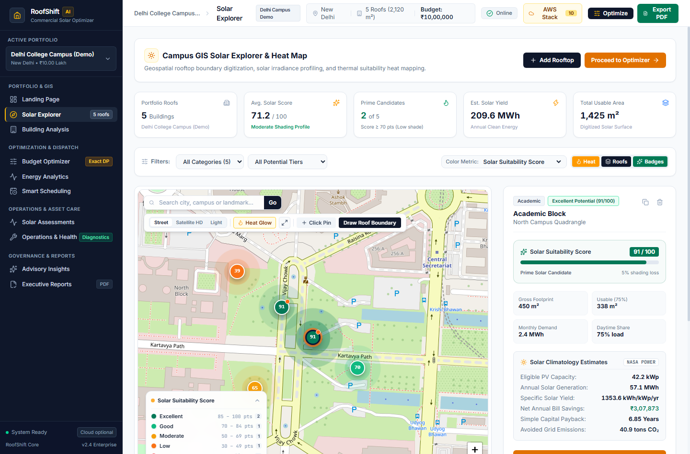
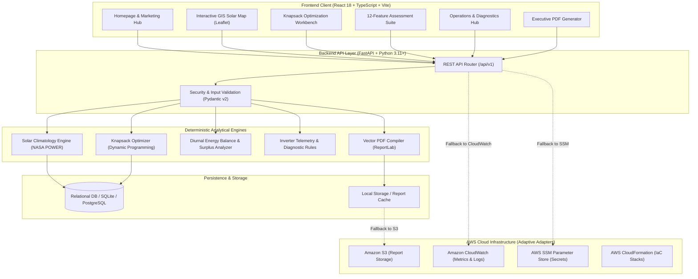

<div align="center">

# ☀️ RoofShift AI

### **Intelligent Rooftop Solar Planning, Energy Analytics & Budget Optimization**

**[Live website — AWS CloudFront](https://d2pxwgtcwn203c.cloudfront.net/) · [GitHub repository](https://github.com/rajsalonia/roofshift-ai) · [Quick start](#8-installation--quick-start) · [API contracts](API_CONTRACTS.md) · [Security policy](SECURITY.md)**

<p align="center">
  A full-stack software platform designed to help institutions, commercial facilities, and multi-building campuses evaluate rooftop solar opportunities through geospatial analysis, solar forecasting, constrained budget optimization, and asset performance diagnostics.
</p>

[](https://python.org)
[](https://fastapi.tiangolo.com)
[](https://react.dev)
[](https://www.typescriptlang.org)
[](https://vitejs.dev)
[](https://tailwindcss.com)
[](https://power.larc.nasa.gov)
[](https://docker.com)
[](#13-testing)
[](#7-system-architecture)

</div>

> [!NOTE]
> **Benchmark vs. observed results:** The 22.4% optimization figure describes a modeled scenario relative to a specified baseline. It is not measured savings from an operating solar installation. Energy, shading, ROI, and financial outputs depend on input assumptions and data quality.

---

## 1. Product Overview

Organizations managing multi-building campuses—such as universities, hospital complexes, commercial real estate portfolios, and industrial facilities—face significant friction when evaluating solar photovoltaic (PV) investments:

- **Information Fragmentation:** Rooftop surface estimates, solar irradiance data, facility consumption profiles, and tariff structures are typically siloed across disparate tools and spreadsheets.
- **Suboptimal Capital Allocation:** Traditional planning relies on naive rules of thumb (e.g., placing solar on the single largest rooftop first), frequently ignoring micro-climate shading penalties, daytime demand coincidence, and diminishing feed-in tariffs.
- **Opaque Payback Scenarios:** Financial forecasts rarely incorporate hourly load profiles or realistic derating factors, producing unreliable ROI estimates.

**RoofShift AI** bridges this gap by unifying geospatial rooftop assessment, physical solar modeling, operations research algorithms, and post-installation diagnostics into a single workflow. The platform empowers facility executives, sustainability directors, and energy engineers to transition from initial satellite discovery to an investment-ready executive solar proposal backed by mathematical optimization.

---

## 2. Product Interface

### Enterprise Homepage
The platform landing interface provides multi-building portfolio metrics, transparent methodology explanations, and direct access to all solar planning modules.


### Interactive Campus GIS Solar Explorer
Digitize building boundaries, calculate usable surface areas via polygon geometry, and inspect localized solar climatology metrics across multiple rooftops.



### Constrained Knapsack Budget Optimizer
Execute exact Pareto-frontier Multiple-Choice Knapsack optimization to maximize portfolio bill savings against fixed capital budgets, demonstrating **+22.4% modeled net annual financial lift compared with a naive allocation baseline in a documented benchmark scenario**.


---

## 3. Core Platform Capabilities

RoofShift AI provides 12 specialized capabilities spanning pre-installation planning, financial modeling, and operational asset management:

| # | Capability | Description | Method / Core Logic | Primary Output |
|---|---|---|---|---|
| **01** | **Solar Location Finder** | Geospatial rooftop discovery and candidate screening across campus portfolios. | Haversine distance, bounding box geocoding, and usable area screening. | Ranked building rooftop candidates with usable area limits. |
| **02** | **Energy Prediction** | Solar photovoltaic yield forecasting across months and weather conditions. | Physical PV derating model ($P = A \cdot \text{GHI} \cdot \eta \cdot \text{PR}$) with NASA POWER climatology. | Monthly generation curves (kWh) and annual specific yields (kWh/kWp). |
| **03** | **Budget Optimizer** | Constrained multi-facility capital allocation solver under fixed budget ceilings. | Exact Decimal Dynamic Programming solving the Multiple-Choice Knapsack Problem (MCKP). | Optimal discrete capacity allocations (kWp), Capex expenditure, and payback windows. |
| **04** | **Electricity Demand Analysis** | High-resolution diurnal load profiling and self-consumption evaluation. | Interval time-series integration (CSV upload or synthesized archetypes). | Baseline monthly consumption curves and daytime demand shares (%). |
| **05** | **Solar Surplus Detection** | Hourly coincidence auditing to detect generation exceeding local consumption. | Diurnal energy balance analysis across 24 hourly timesteps. | Hourly surplus export profile and self-consumption fraction. |
| **06** | **Smart Scheduling** | Flexible load shifting to maximize on-site solar absorption. | Rule-based dispatch optimization prioritizing high-solar operating hours. | Optimized load schedules reducing peak grid import tariffs. |
| **07** | **Solar Monitoring** | Telemetry tracking and IEC 61724 standard Performance Ratio auditing. | Weather-adjusted expected generation comparison vs. measured inverter output. | Operational Performance Ratio (PR) and historical degradation rates (%/yr). |
| **08** | **Panel Health & Fault Detection** | Diagnostic anomaly detection from operational telemetry. | Symptom-based rule heuristics identifying string mismatch, shading, or cell degradation. | Categorized diagnostic findings with severity levels and affected panel strings. |
| **09** | **Maintenance Advisor** | Prioritized operational maintenance and cleaning recommendations. | Multi-factor risk scoring evaluating soiling thresholds, inspection intervals, and yield losses. | Structured maintenance action items with financial urgency scoring. |
| **10** | **Financial Savings Calculator** | Comprehensive discounted cash flow and net savings modeling. | 25-year lifecycle cash flow modeling with annual degradation and tariff escalation. | Net Present Value (NPV), Internal Rate of Return (IRR), and capital payback period. |
| **11** | **Environmental Impact Assessment** | Quantified carbon offset and environmental sustainability reporting. | Grid emission displacement factors (e.g., CEA baseline of $0.716\text{ kg CO}_2\text{e/kWh}$). | Annual avoided metric tons of $\text{CO}_2$, vehicle equivalents, and tree-year equivalents. |
| **12** | **Report Generator** | Automated executive investment proposals in professional vector PDF format. | ReportLab 3.x vector layout engine with dynamic charts and portfolio summaries. | Downloadable multi-page PDF proposal with formal disclaimers and financial schedules. |

---

## 4. How RoofShift AI Works

```
┌─────────────────────────────────┐
│     1. Geospatial Discovery     │  Search location, digitize rooftop boundaries,
│    (Leaflet GIS & Polygons)     │  and compute usable surface area.
└────────────────┬────────────────┘
                 │
┌────────────────▼────────────────┐
│      2. Solar Climatology       │  Fetch NASA POWER GHI data, apply orientation
│     (Physical Irradiance)       │  derating, and establish specific solar yield.
└────────────────┬────────────────┘
                 │
┌────────────────▼────────────────┐
│    3. Energy Demand Modeling    │  Ingest meter CSV or synthesize campus load archetypes
│     (Diurnal Coincidence)       │  to determine daytime self-consumption potential.
└────────────────┬────────────────┘
                 │
┌────────────────▼────────────────┐
│      4. Budget Optimization     │  Solve Multiple-Choice Knapsack problem to allocate
│    (Dynamic Programming/MCKP)   │  capital across candidate rooftops for maximum savings.
└────────────────┬────────────────┘
                 │
┌────────────────▼────────────────┐
│     5. Operational Care & QA    │  Track inverter telemetry, audit Performance Ratio,
│   (Diagnostics & Maintenance)   │  and triage maintenance cases.
└────────────────┬────────────────┘
                 │
┌────────────────▼────────────────┐
│    6. Proposal PDF Delivery     │  Compile mathematical findings, financial schedules,
│     (ReportLab Vector Engine)   │  and engineering notes into a downloadable document.
└─────────────────────────────────┘
```

---

## 5. System Architecture

RoofShift AI is engineered with clean separation of concerns, ensuring high performance, explainability, and full offline local execution capability:



---

## 6. Technology Stack

### Frontend
- **Framework:** React 18.3 with TypeScript 5.6
- **Tooling:** Vite 8.3 (Fast HMR, sub-second production bundling)
- **Styling:** Tailwind CSS 3.4 with custom design tokens (`#FF6B16` Solar Amber, `#0B1739` Deep Obsidian)
- **Mapping:** Leaflet 1.9 & React-Leaflet with Leaflet-Draw for custom polygon roof digitizing
- **Data Visualization:** Recharts 2.x for diurnal coincidence curves and monthly production charts
- **Icons:** Lucide React

### Backend
- **Framework:** FastAPI 0.115+ (Asynchronous ASGI framework)
- **Language:** Python 3.11 / 3.12 / 3.14 compatible
- **Data Validation:** Pydantic v2 (Strict typing, serialization, and schema validation)
- **Database ORM:** SQLAlchemy 2.0 with SQLite (development/offline) and PostgreSQL readiness
- **Document Generation:** ReportLab 3.x (Multi-page vector layout engine)

### Computation & Analytics
- **Operations Research:** Exact Decimal Dynamic Programming for the Multiple-Choice Knapsack Problem (MCKP)
- **Solar Climatology:** NASA POWER Climatology API client with 0.1° geographic coordinate caching
- **Geospatial Geometry:** Shoelace formula polygon area calculation with spherical latitude correction
- **Environmental Modeling:** Central Electricity Authority (CEA) grid baseline emission factors

### Infrastructure & Cloud
- **Containers:** Docker and Docker Compose multi-stage configurations
- **Web Server:** Nginx reverse proxy configurations
- **Infrastructure as Code:** AWS CloudFormation templates
- **Cloud Adapters:** Modular Python adapters for AWS services with zero-cost local fallbacks
- **Continuous Integration:** GitHub Actions automated test workflows

---

## 7. AWS Cloud Architecture & Implementation Status

RoofShift AI includes an adaptive cloud architecture designed for Amazon Web Services. Every cloud touchpoint uses an abstracted service adapter with a transparent local fallback, enabling full functionality both in cloud environments and locally offline.

### Implementation Status Matrix

| AWS Service | Architecture Role | Implementation Status | Local Fallback Behavior |
|---|---|---|---|
| **AWS STS** | Identity verification and caller authentication | **Live Integrated** | Evaluated via AWS CLI v2 profile configuration. |
| **AWS Budgets / Cost Explorer** | Cost monitoring and spending containment alerts | **Live Integrated** | Zero-spend status verified ($0.00 MTD spend). |
| **AWS CloudFormation** | Infrastructure-as-Code automated stack provisioning | **Infrastructure Ready** | Validated template at `infrastructure/aws/cloudformation-template.yaml`. |
| **Amazon EC2** | Application hosting via Docker and Nginx reverse proxy | **Infrastructure Ready** | Shell deployment automation at `infrastructure/aws/deploy-ec2.sh`. |
| **Amazon S3** | Cloud object storage for generated PDF proposals | **Implemented, Not Deployed** | File storage falls back cleanly to local filesystem (`generated_reports/`). |
| **Amazon CloudWatch** | Application logging and operational metric monitoring | **Implemented, Not Deployed** | Telemetry logs fall back to standard Python logging handlers. |
| **AWS Systems Manager (SSM)** | Centralized parameter storage and environment secrets | **Implemented, Not Deployed** | Configuration falls back to local `.env` and environment variables. |
| **Amazon Location Service** | Enterprise address geocoding and reverse geocoding | **Implemented, Not Deployed** | Geocoding falls back to OpenStreetMap Nominatim API. |
| **AWS Lambda** | Event-driven solar assessment background processing | **Planned** | Outlined in roadmap for batch portfolio ingestion. |
| **Amazon Bedrock** | Generative AI and LLM inference | **Hard-Disabled** | Explicitly disabled (`BEDROCK_ENABLED = False`) to guarantee deterministic mathematics and eliminate cloud inference costs. |

> **Financial Safety Directive:** All cloud operations adhere to a strict zero unauthorized spending policy. The system operates fully using local fallbacks and does not require active cloud provisioning to execute assessments or generate reports.

---

## 8. Installation & Quick Start

### Prerequisites
- **Python:** 3.11 or later (`python --version`)
- **Node.js:** 18.0 or later with npm (`node --version`)
- **Git:** 2.30 or later (`git --version`)

### Linux / macOS Setup

```bash
# 1. Clone repository
git clone https://github.com/rajsalonia/roofshift-ai.git
cd roofshift-ai

# 2. Setup backend virtual environment
python3 -m venv venv
source venv/bin/activate
pip install --upgrade pip
pip install -r backend/requirements.txt
cp .env.example .env

# 3. Launch backend API server
python -m uvicorn app.main:app --app-dir backend --host 127.0.0.1 --port 8000 --reload

# 4. Setup and launch frontend (in a separate terminal)
cd frontend
npm install
npm run dev
```

### Windows Setup (PowerShell)

```powershell
# 1. Clone repository
git clone https://github.com/rajsalonia/roofshift-ai.git
cd roofshift-ai

# 2. Setup backend virtual environment
python -m venv venv
.\venv\Scripts\Activate.ps1
python -m pip install --upgrade pip
pip install -r backend/requirements.txt
Copy-Item .env.example .env

# 3. Launch backend API server
python -m uvicorn app.main:app --app-dir backend --host 127.0.0.1 --port 8000 --reload

# 4. Setup and launch frontend (in a separate terminal)
cd frontend
npm install
npm run dev
```

- Open **`http://localhost:5173`** to access the web application.
- Open **`http://localhost:8000/docs`** for interactive OpenAPI / Swagger API documentation.

---

## 9. API Capabilities & Key Endpoints

The backend exposes structured REST endpoints under the `/api/v1` namespace:

| Endpoint Group | Key Routes | Description |
|---|---|---|
| **Health & System** | `GET /api/v1/health`<br>`GET /api/v1/system/integrations` | System health status and AWS cloud adapter status matrix. |
| **Portfolios & Projects** | `GET /api/v1/projects`<br>`POST /api/v1/projects`<br>`GET /api/v1/projects/{id}` | Portfolio lifecycle management, geographic coordinates, and tariff parameters. |
| **Buildings & Rooftops** | `GET /api/v1/projects/{id}/buildings`<br>`POST /api/v1/projects/{id}/buildings` | Rooftop polygons, gross/usable areas, demand metrics, and shading profiles. |
| **Solar Climatology** | `POST /api/v1/solar/analyze`<br>`GET /api/v1/projects/{id}/solar` | NASA POWER solar irradiance retrieval, derating calculations, and monthly yields. |
| **Knapsack Optimizer** | `POST /api/v1/projects/{id}/optimize` | Exact Multiple-Choice Knapsack budget allocation across campus rooftops. |
| **Energy & Surplus** | `GET /api/v1/projects/{id}/energy`<br>`POST /api/v1/energy/surplus` | Diurnal hourly generation vs. load balance and export calculations. |
| **Smart Scheduling** | `POST /api/v1/scheduling/optimize` | Shiftable load dispatch recommendations aligned with peak solar production. |
| **Feature Assessments** | `GET /api/v1/projects/{id}/features/templates`<br>`POST /api/v1/projects/{id}/features/assessments` | 8 structured assessment templates (location finder, sensitivity, impact, etc.). |
| **Asset Operations** | `POST /api/v1/inspections/analyze`<br>`POST /api/v1/monitoring/telemetry` | Panel anomaly classification, inverter telemetry PR auditing, and maintenance triage. |
| **Executive Reports** | `POST /api/v1/projects/{id}/reports`<br>`GET /api/v1/reports/{id}/download` | Vector PDF report generation and direct binary document download. |

---

## 10. Data Sources & Scientific Methodologies

1. **Solar Climatology Data:**
   - Source: NASA Prediction of Worldwide Energy Resources (POWER) Climatology API.
   - Parameters: Global Horizontal Irradiance (`ALLSKY_SFC_SW_DWN`, $\text{kWh}/\text{m}^2/\text{day}$).
   - Caching: 0.1° geographic coordinate grid cache with automatic fallback to regional IMD/NISE baselines.
2. **Performance Derating Standards:**
   - Standard: IEC 61724 standard Performance Ratio ($75.0\%$ default benchmark).
   - Derating Components: Inverter efficiency ($96.5\%$), DC cabling losses ($2.0\%$), temperature coefficients ($3.0\%$), and environmental dust/soiling ($2.5\%$).
3. **Carbon Emission Accounting:**
   - Source: Central Electricity Authority (CEA) of India CO2 baseline database.
   - Grid Displacement Factor: **$0.716\text{ kg CO}_2\text{e}/\text{kWh}$** default for Indian regional grids.
4. **Optimization Modeling:**
   - Formulation: Multiple-Choice Knapsack Problem (MCKP) with discrete 0.5 kWp capacity steps.
   - Objective: Maximize net annual bill savings (INR) within an exact capital budget ceiling (Capex $\le B$).

---

## 11. Testing & Verification

RoofShift AI maintains comprehensive automated test suites covering backend mathematical correctness, API schemas, and frontend build integrity:

```bash
# Execute backend test suite
python -m pytest -o pythonpath=backend backend/tests -v
```

```
============================= test session starts =============================
platform win32 -- Python 3.14.7, pytest-9.1.1
collected 195 items

backend/tests/test_advanced_engine_correctness.py ...................... [ 11%]
.................................                                        [ 28%]
backend/tests/test_api_endpoints.py ...                                  [ 29%]
backend/tests/test_application_integration.py .....                      [ 32%]
backend/tests/test_feature_analytics.py ................................ [ 48%]
..............                                                           [ 55%]
backend/tests/test_feature_api.py ......................                 [ 67%]
backend/tests/test_feature_monitoring.py ............................... [ 83%]
..............                                                           [ 90%]
backend/tests/test_integration_provenance.py ..                          [ 91%]
backend/tests/test_optimizer.py ..                                       [ 92%]
backend/tests/test_solar_engine.py ...                                   [ 93%]
backend/tests/test_v2_acceptance.py ............                         [100%]

===================== 195 passed, 401 warnings in 12.68s ======================
```

```bash
# Execute frontend TypeScript and Vite production compilation
cd frontend
npm run build
```

```
✓ 2563 modules transformed.
✓ built in 631ms (0 TypeScript errors)
```

---

## 12. Repository Structure

```
roofshift-ai/
├── .github/
│   └── workflows/
│       └── ci.yml                     # Automated CI test and build workflow
├── backend/
│   ├── app/
│   │   ├── api/v1/                    # REST route controllers
│   │   ├── core/                      # Configuration and database sessions
│   │   ├── models/                    # SQLAlchemy database schemas
│   │   ├── schemas/                   # Pydantic v2 data models
│   │   └── services/                  # Business logic & analytical engines
│   │       ├── energy/                # Diurnal balance and surplus logic
│   │       ├── features/              # Specialized feature templates & analytics
│   │       ├── optimization/          # Knapsack budget solver (MCKP)
│   │       ├── reports/               # ReportLab PDF compiler
│   │       └── solar/                 # NASA POWER climatology integration
│   ├── requirements.txt               # Python package dependencies
│   └── tests/                         # Automated pytest test suites (195 tests)
├── frontend/
│   ├── public/                        # Static web assets and imagery
│   ├── src/
│   │   ├── components/                # Reusable UI components & modals
│   │   │   ├── home/                  # Homepage section components
│   │   │   ├── layout/                # Navigation and sidebar shell
│   │   │   └── map/                   # Leaflet GIS solar map and draw tools
│   │   ├── pages/                     # Application route views
│   │   └── services/                  # Axios API communication clients
│   ├── package.json                   # Frontend dependencies
│   └── vite.config.ts                 # Vite bundler configuration
├── docs/
│   ├── assets/                        # Documentation screenshots & figures
│   ├── ARCHITECTURE.md                # Detailed technical system specifications
│   ├── AWS_DEPLOYMENT.md              # CloudFormation and EC2 deployment guide
│   ├── DATA_SOURCES.md                # Scientific sources and calculation disclaimers
│   ├── DEMO.md                        # Institutional campus walkthrough scenario
│   ├── FEATURES.md                    # Detailed capability specifications
│   └── SETUP.md                       # Comprehensive environment setup guide
├── infrastructure/
│   └── aws/                           # CloudFormation and EC2 deployment scripts
├── .env.example                       # Sample environment variable template
├── .gitignore                         # Comprehensive Git ignore rules
├── docker-compose.yml                 # Local container orchestration
└── README.md                          # Repository documentation
```

---

## 13. System Assumptions & Limitations

- **Irradiance Resolution:** Climatological solar yield estimates use historical monthly averages from NASA POWER rather than real-time minute-by-minute pyranometer readings.
- **Rooftop Structural Integrity:** Calculated capacities represent theoretical physical maximums based on digitized surface area; on-site structural engineering inspections are mandatory prior to physical procurement.
- **Telemetry Ingestion:** The operational monitoring interface currently processes historical intervals and sample telemetry datasets; direct continuous SCADA / Modbus hardware ingestion is planned for future releases.
- **Financial Projections:** Electricity bill savings and payback calculations are based on user-supplied import tariffs, net-metering export rates, and standard degradation assumptions ($0.5\%/\text{year}$).

---

## 14. Development Roadmap

- [x] Multi-facility Multiple-Choice Knapsack budget optimization
- [x] High-resolution diurnal solar surplus coincidence modeling
- [x] Inverter telemetry Performance Ratio and degradation auditing
- [x] Multi-page ReportLab vector PDF proposal generator
- [x] 12 specialized solar assessment engines and history tracking
- [x] Comprehensive AWS CloudFormation and Docker deployment templates
- [ ] Direct RS-485 / Modbus RTU inverter hardware gateway integration
- [ ] 3D LiDAR point-cloud shadow tracing for complex parapets and obstacles
- [ ] Multi-tenant institutional portfolio aggregation and district-level microgrid balancing

---

## 15. Maintainer & Contact

- **Project Lead & Maintainer:** [@rajsalonia](https://github.com/17rajsal)
- **Repository:** [https://github.com/rajsalonia/roofshift-ai](https://github.com/rajsalonia/roofshift-ai)

---

<div align="center">

**RoofShift AI — Turning rooftop solar potential into explainable, data-informed energy decisions.**

</div>
