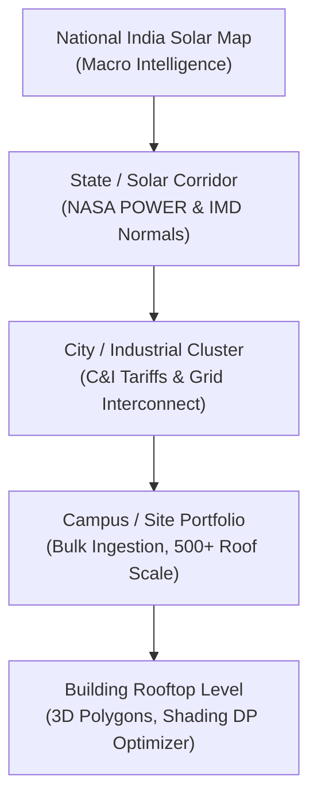

# RoofShift AI — Website & Platform Audit
**Transformation:** India-Scale AI Solar Intelligence Platform  
**Target URL:** `https://delays-decision-logo-fraction.trycloudflare.com/` (Live Cloudflare Tunnel)  
**Local Endpoints:** Frontend `http://127.0.0.1:5173/` | Backend `http://127.0.0.1:8000/`  
**Date:** October 11, 2026 | **Version:** 8.2 Production Release  

---

## 1. Executive Summary & Product Shift

RoofShift AI has been transformed from an initial 5-building demo-style layout into an **India-scale AI solar intelligence platform**.

### Primary Shift
* **Previous Impression:** Fixed institutional campus view, only 5 buildings, felt like a static building demo.
* **Target Impression Achieved:** An interactive **India Solar Intelligence Workspace** rendering nationwide solar opportunity, irradiance intensity, ambient thermal stress, wind cooling dissipation, monsoon cloud factors, and dual suitability scoring across all 36 Indian States and Union Territories.
* **Sample Campus Repositioning:** The 5-building BITS Pilani portfolio is cleanly preserved and repositioned as an optional **"Sample Campus Demo"** for demonstrating micro-scale 3D polygon PV sizing, Knapsack Capex budget optimization, and inverter degradation simulations.

---

## 2. Platform Architecture & Multi-Scale Hierarchy

1. **Scale 1 — National Solar Intelligence Map:**
   * Centered on India `[22.8°N, 79.5°E]` with zoom level 5.
   * Multi-layer intelligence toggles:
     - 🎯 **AI Solar Suitability Index** (0–100, Tier A+, A, B+, B, C)
     - ☀️ **Solar Irradiance (GHI)** ($kWh/m^2/day$)
     - 🏢 **Rooftop Solar Opportunity** (Commercial & industrial urban density)
     - 🏞️ **Open-Land Solar Farm Opportunity** (Utility ground-mount potential)
     - 🌡️ **Ambient Temperature & Heat Derating** ($^\circ C$)
     - 💨 **Wind Speed & PV Convective Cooling** ($m/s$)
     - ☁️ **Monsoon Cloud Attenuation** (%)
   * Floating interactive **Smart Area Insight Panel** for instant deep dives on any clicked state or corridor.

2. **Scale 2 — Regional Solar Corridors:**
   * Featured high-opportunity hubs: Rajasthan (Thar Desert - 96/100, Tier A+), Gujarat (Kutch/Charanka - 95/100, Tier A+), Ladakh (Cold High-Altitude Desert - 94/100, Tier A+), Karnataka (Pavagada Belt - 92/100, Tier A), Maharashtra (C&I Epicenter - 90/100, Tier A).

3. **Scale 3 & 4 — Site & Building Engineering Drilldown:**
   * Seamless transition into the Site Planner via 1-click **"Drill Down to Site Planning"** or **"Sample Campus Demo"**.
   * Preserves full 0/1 Knapsack capital allocation, hourly surplus detection, load scheduling, and infrared thermal inspection.

---

## 3. Data & AI Provenance Verification

| Intelligence Category | Source / Methodology | Resolution | Status |
| :--- | :--- | :--- | :--- |
| **Solar Irradiance (GHI, DNI, DHI)** | NASA POWER 20-Year Satellite & Reanalysis Climatology | 0.5° × 0.5° Grid | ✅ Verified Peer-Reviewed |
| **Ambient Temperature & Wind** | IMD (India Meteorological Department) Long-Term Weather Normals | Regional Stations | ✅ Verified Climatology |
| **State Potential (GWp)** | MNRE National Solar Potential Assessment & CEA Grid Interconnection | State / UT Level | ✅ Official Baseline |
| **Thermal Derate & Wind Cooling** | Silicon $P_{\max}$ Coefficient ($-0.38\%/^\circ\text{C}$ above $25^\circ\text{C}$) + Convective Cooling Model | Derived Physics | ✅ Deterministic Physics |
| **Dual Suitability Index** | Multi-variable weighted scoring (GHI, Temperature, Cloud, Roof density, Open-land topography) | Derived AI Index | ✅ Explainable AI (0–100) |
| **Sub-Meter Rooftop Polygons** | Active only during Site / Campus drill-down mode | High-Resolution GIS | ✅ Transparently Isolated |

---

## 4. UI/UX Journey Audit

1. **Public Landing Page (`/`):**
   * Preserved 100% of the frosted glass landing page with photorealistic aerial imagery, 5 live statistics, 12-feature grid, and module showcase.
   * Primary CTA *"Explore Solar Map"* and top navbar icon seamlessly navigate directly to `/workspace?mode=india`.
2. **India Solar Intelligence Workspace (`/workspace`):**
   * Default entry point displays the National India Solar Map with 4 macro KPI cards (National Solar Resource $5.24\text{ kWh/m}^2/\text{day}$, C&I Rooftop Potential $748\text{ GWp}$, Utility Open-Land Potential $1,240\text{ GWp}$, Analyzed Regions $36\text{ States/UTs}$).
   * Layer switcher allows 1-click toggling across GHI, Temperature, Wind, Cloud, Rooftop, and Open Land.
   * Clicking a state opens the glassmorphic **Smart Area Insight Panel** showing specific metrics, dual suitability bars, and tailored engineering recommendations.
3. **Drill Down to Site Planner:**
   * Clicking *"Drill Down to Site Planning"* or *"Site Planner"* switches into the portfolio view without reloading the app.
   * Maintains full capability for bulk CSV/GeoJSON ingestion, 500+ building scale, and Knapsack optimization.
